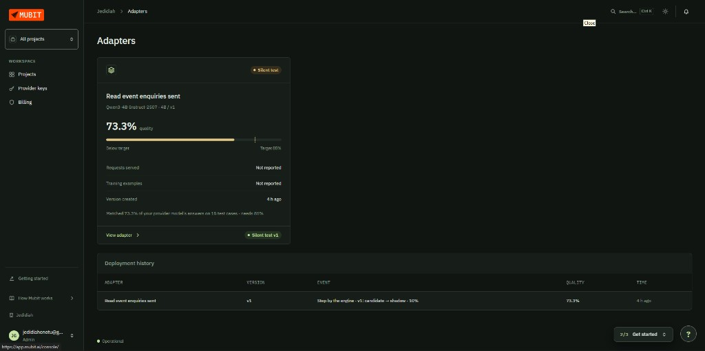
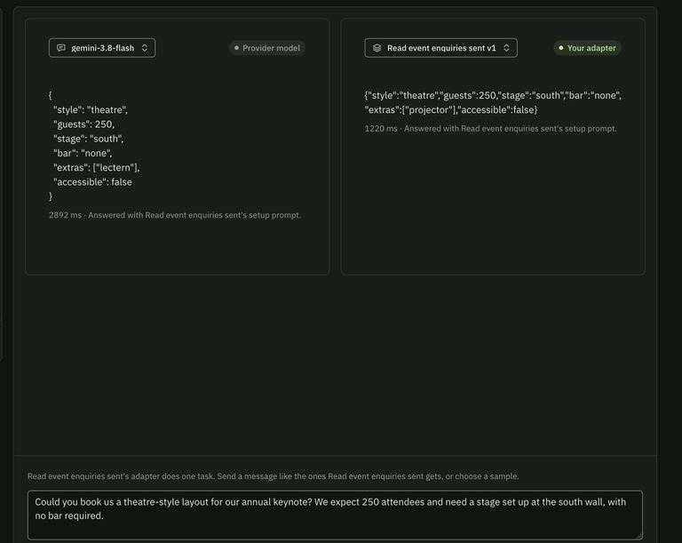
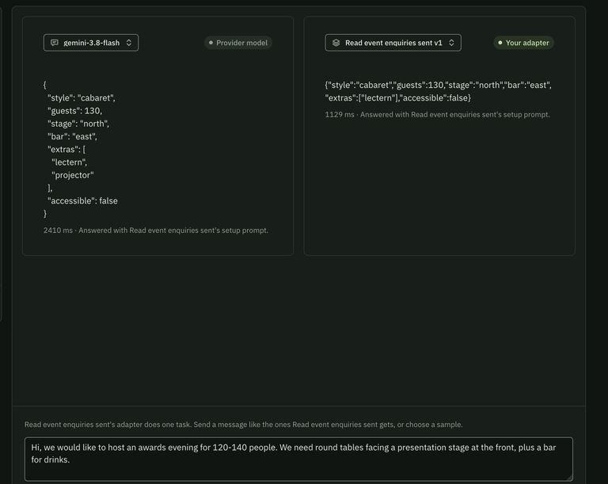
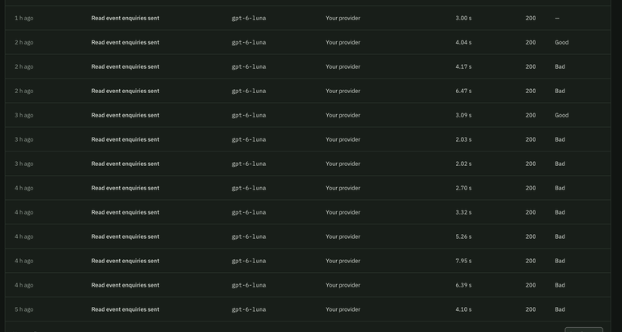

# BriefToFloor

**Venues get event enquiries all day. Before they can reply, someone has to read each email, decide the room setup, check it fits, sketch a layout and work out a price. BriefToFloor does that in seconds: an enquiry comes in, the hall builds itself in 3D, and every fix the coordinator makes teaches a model the venue owns, trained through Mubit.**

Built in 42 hours at **Night Shift**, the Mubit hackathon in London (23–25 Oct 2026).

| | |
|---|---|
| **Live app (venue side)** | https://mubit-hackathon.vercel.app |
| **Enquiry form (organiser side)** | https://mubit-hackathon.vercel.app/enquire |
| **Example client proposal** | https://mubit-hackathon.vercel.app/p/enq-demo-proposed |
| **Track** | Recurring tasks, plus a quality / cost / latency comparison against the closed model |
| **Demo video** | *(attached to the submission, 2 min)* |

---

## Demo video walkthrough

The 2-minute video follows one enquiry from both sides. Approximate timestamps:

| Time | What you see | Where it's explained below |
|---|---|---|
| 0:00 | **The venue's inbox.** Every enquiry is already read through Mubit and tagged Fits / Can't host, Needs review, with an estimated price | [What BriefToFloor does](#what-brieftofloor-does) |
| 0:10 | **Venue setup.** The venue's rooms, sizes, capacity per layout, features and prices. Plain code uses this data; it never goes into the AI prompt | [How we use Mubit](#how-we-use-mubit) |
| 0:20 | **Stats.** Our held-out eval of plain GPT vs correction notes vs rules in the prompt, and the adapter grade | [Results](#results) |
| 0:30 | **An enquiry becomes a 3D hall.** The AI's setup is laid out by code in the venue's real room | [The 3D hall](#the-3d-hall) |
| 0:45 | **The Mubit console.** Every call lands in the one task "Read event enquiries sent"; the request detail shows the email in and the setup JSON out | [How we use Mubit](#how-we-use-mubit) |
| 0:55 | **The organiser enquires** on the public form ("Enquire about a date"): a wedding with a buffet, described in their own words | [The organiser's journey](#the-organisers-journey) |
| 1:10 | **It appears in the venue's inbox,** gets read, and the hall builds in the best-fitting room | [What BriefToFloor does](#what-brieftofloor-does) |
| 1:20 | **Edit layout.** The coordinator moves and adds pieces in plan view, with placement checks | [The 3D hall](#the-3d-hall) |
| 1:30 | **Approve & draft reply.** A code-written reply with the room, the price and the client's plan link | [What BriefToFloor does](#what-brieftofloor-does) |
| 1:35 | **The organiser's proposal page.** Their event in 3D with the quote; they ask the venue for a change in plain English | [The organiser's journey](#the-organisers-journey) |
| 1:45 | **Back at the venue.** The request shows under *Client changes*; the coordinator accepts and the hall rebuilds. Accepted client edits are saved as corrections that feed the Mubit loop | [Turning corrections into model updates](#2-turning-corrections-into-model-updates) |

---

## Contents

0. [Demo video walkthrough](#demo-video-walkthrough)
1. [The problem](#the-problem)
2. [What BriefToFloor does](#what-brieftofloor-does)
3. [How we use Mubit](#how-we-use-mubit)
4. [Results](#results)
5. [Architecture](#architecture)
6. [The 3D hall](#the-3d-hall)
7. [The organiser's journey](#the-organisers-journey)
8. [Code tour](#code-tour)
9. [Run it yourself](#run-it-yourself)
10. [Tests](#tests)
11. [Honest limits](#honest-limits)
12. [What's next](#whats-next)
13. [Team and credits](#team-and-credits)

---

## The problem

A wedding venue, hotel or conference centre gets emails like this every day:

> *"We're getting married in June, around 120 guests. Sit-down dinner, then speeches, then dancing. One of our guests uses a wheelchair, so we'll need step-free access."*

Before the coordinator can reply, she has to:

1. **Work out what the client means.** Speeches mean a stage and a lectern, dancing means a dance floor, and a wheelchair user means step-free access.
2. **Check it fits.** A dance floor takes seats away, and one room has stairs only.
3. **Pick the room.**
4. **Sketch a layout** so the client can picture it.
5. **Price it:** room hire, per head, extras, VAT.

She does this by hand, one email at a time. The venue that replies first with a clear offer often wins the booking. Venue software companies already sell products to speed up enquiry replies (for example, iVvy's AI "Instant Proposal") and 3D floor plans (Tripleseat's partnership with Prismm), so venues already pay to solve this.

The hard part is the first step. Clients rarely say "banquet, 120, stage north, dance floor, accessible". They say "drinks then a sit-down dinner", "the captain hands out the trophies" or "my nan uses a walker". Keyword rules can't read that, and every venue has its own conventions on top ("awards nights here are always cabaret").

---

## What BriefToFloor does

### For the venue coordinator

- **Inbox.** Enquiries arrive from the public form, by paste, or by email webhook. Each one is read automatically and tagged **Fits / Fits · tight / Can't host**, **Needs review / Needs info**, with an estimated total.
- **Enquiry view.** The email, the AI's draft setup (style, guests, stage, bar, extras, step-free access) and the venue's hall laid out in 3D from that setup. The room check and quote update live.
- **One-click fixes.** If the draft is wrong (say it chose reception when the client wants a seated dinner), the coordinator changes the field, the hall rearranges, and **the fix is saved as a correction that teaches the next draft**.
- **Teach once, fixes everywhere ("ripple").** When a corrected enquiry is approved, waiting enquiries with the same cue (another awards night, another walker) are re-read with the fix applied, and the coordinator gets a "fixed by your correction" note.
- **Edit layout.** Move, rotate, add or delete pieces in the 3D hall, with placement checks ("Something's already there", "Keep the exit and step-free route clear").
- **Approve & draft reply.** A reply written by code with the room, the setup, the price and a link to the client's 3D plan.

### For the event organiser (the client)

- **Enquire** at `/enquire` and get a live status page: Received → Venue reviewing → Proposal ready → Confirmed.
- **Proposal page** with their event in 3D, what's included, and the quote.
- **Request changes.** Switch layout, add a dance floor, move the stage, add a note. The 3D view and price update live, and the request goes to the coordinator, who accepts or dismisses it. Accepted client edits also become corrections.
- **Ask the venue** in plain English ("can the stage go on the west wall?"), turned into a proposed change for the coordinator.
- **Confirm booking**, which locks the plan.

---

## How we use Mubit

Mubit sits between an app and its model provider. It records every call, groups calls that share a model, system prompt and output format into a **task**, and trains a small open **adapter** model for that task. We designed the whole product around that.

### 1. Exactly one AI job

There is **one** LLM call type in the product: `runParse` (`lib/run-parse.ts`). An enquiry goes in and a short JSON setup comes out:

```json
{ "style": "banquet", "guests": 120, "stage": "north", "bar": "east",
  "extras": ["dance_floor", "lectern"], "accessible": true }
```

Everything after that is plain, deterministic, unit-tested TypeScript: feasibility, room choice, table layout, quote, reply text and 3D. That gives Mubit one clean, repetitive task to learn, a task where right and wrong are easy to measure, and a small output a 4B model can realistically match.

- **Frozen system prompt and model** (`lib/parse.ts`, `gpt-6-luna`). Venue rooms, prices and dates never go into the prompt, because changing the prompt would start a new task.
- **The same call path** is used by the inbox, the paste box, the email webhook, the public form, ripple re-reads and "Ask the venue". All of them feed the same task. "Ask the venue" composes an enquiry-shaped message (original email plus the client's update) so its examples look like the rest.
- **Server-side only** (Mubit has no CORS support). The Mubit request ID (`x-middleware-request-id`) and latency are stored on every enquiry and shown in the UI.

### 2. Turning corrections into model updates

Mubit adapters are trained on the provider model's answers, and there is no API to submit a corrected answer. So we make the provider produce the corrected answer, and let Mubit keep it:

1. A coordinator fixes a field. The fix is stored with the original email and the Mubit request ID (`lib/corrections.ts`, Firestore).
2. On every new enquiry, the most relevant past corrections, matched by event cue (`lib/cues.ts`: awards, AGM, quiz, Christmas, memorial, mobility…) and by text similarity, go into the **user message** as short notes above the email. The system prompt stays frozen.
3. GPT applies the venue's conventions, and Mubit records that **corrected** answer as a training example for the task.
4. The next adapter version trains on those examples. The goal is a small model that has learned the venue's habits and no longer needs the notes, which removes their token and latency cost.

Client-side edits accepted by the coordinator follow the same path (`source: "client"`). Manual furniture moves are deliberately **not** corrections, because they are positions, not something the model misread.

### 3. Venue house rules a general model can't know

Our test venue has conventions a general model has no reason to guess:

- Awards, prize-giving and trophy nights are **cabaret**, with stage north and a lectern.
- AGMs, shareholder and members' meetings are **theatre**.
- Quiz nights and tastings are **cabaret**.
- Christmas parties are **banquet** with a bar, dance floor and DJ booth.
- Wakes and memorials are **reception** with a buffet.
- Mixers, launches and engagement parties are **reception**.
- Any mobility need (walker, crutches, scooter, stairs) means **accessible**.

These rules are **never** in the production prompt. They reach the model only through coordinator corrections. "GPT with the rules written into the prompt" is the baseline we measure against.

### 4. Clean evaluation

- Held-out sets: `data/test-house.json` (20 emails) and `data/test-set.json` (16). They are never used as demo or seed data.
- Every eval call sends **`x-middleware-record: off`**, so the exam never becomes training data.
- `npm run eval -- [plain|notes|rules] data/test-house.json --runs 3` averages repeated runs, because the same set can swing between runs.
- Scoring (`lib/score.ts`): exact match for style, stage, bar and accessible; guests within ±5%; extras by F1. "Exact" means every field is right.

---

## Results

### Provider model on 20 held-out enquiries (3 runs averaged)

| Mode | All fields right | Field accuracy | Median latency | Tokens (20 emails) |
|---|---|---|---|---|
| **Plain**: GPT, frozen prompt, no venue knowledge | 63.3% | 93.9% | 1.9 s | 7,141 |
| **Notes**: GPT plus coordinator corrections as notes *(what the app does)* | **83.3%** | 96.8% | 2.6 s | 17,486 |
| **Rules**: GPT with house rules in the prompt *(baseline)* | 81.7% | 97.7% | 1.6 s | 9,474 |

What this shows:
- **Corrections work.** Without any rules in the prompt, the coordinator's corrections take fully correct answers from **63% to 83%**, level with writing the rules into the prompt by hand (82%).
- **They cost tokens.** The notes more than double token use and add latency. That is exactly the cost the adapter is meant to remove: learn the venue's habits once, then answer without the notes.

### Mubit adapter

| | |
|---|---|
| **Version** | v1, trained by Mubit on our task on Saturday afternoon |
| **Base model** | Qwen3-4B-Instruct (4B parameters, open weights) |
| **Mubit's grade** | **73.3%** agreement with GPT's answers on 15 test cases (target 85%: below target) |
| **Status** | Silent test: Mubit runs v1 next to GPT on 10% of live traffic and grades the pairs. The next step is canary serving, which needs 50 graded pairs. |
| **v2** | Queued for Mubit's next training run. It is the first version trained on calls that carry the later corrections as notes. |

Live grades and the full comparison table are on the `/stats` page in the app.



### Our adapter vs the provider model, side by side

We ran real enquiries through Mubit's **Try models** page. It sends the same message, with the task's frozen setup prompt, to a provider model (left) and to our adapter v1 (right).

| Enquiry | Provider model | Our adapter (Qwen3-4B, v1) | Same core setup? | Speed-up |
|---|---|---|---|---|
| Annual keynote, 250 attendees, theatre, stage south wall, no bar | theatre · 250 · stage south · no bar · lectern · **2,892 ms** | theatre · 250 · stage south · no bar · projector · **1,220 ms** | ✅ style, guests, stage, bar, access (extras differ) | **2.4× faster** |
| Awards evening for 120–140, round tables facing a stage, bar | cabaret · 130 · stage north · bar east · lectern + projector · **2,410 ms** | cabaret · 130 · stage north · bar east · lectern · **1,129 ms** | ✅ style, guests, stage, bar, access (extras differ) | **2.1× faster** |

On both enquiries the adapter matched the provider on every field that decides the room (layout, guest count, stage and bar position, access). It differed only on optional extras, and it answered **in less than half the time**. That's the Track 2 trade-off we were after: a small open model the venue owns, giving the same room setup at about twice the speed. Mubit's own grade of 73.3% counts every field, extras included, which is why v1 is still marked below target.

> Note: Try models used `gemini-3.8-flash` as the provider in this comparison. Production traffic uses `gpt-6-luna`.




### Corrections in the Mubit console

Every call the app makes appears in Mubit's **Requests** page under the task "Read event enquiries sent". Calls the coordinator corrected in the app are rated **Bad** in the console and correct ones **Good**, so the record Mubit trains from reflects the human review. Over the weekend the app sent **242 calls in 24 hours** through Mubit, all to the same task.



---

## Architecture

```
 Event organiser ──email / form──▶  Inbox
                                      │
                                      ▼
                        /api/parse  ── runParse ──────────▶  Mubit gateway ──▶ GPT (gpt-6-luna)
                        (the ONLY AI call)  ◀── setup JSON ──      │ records every call
                        email + past fixes as notes                 ▼
                                      │                       Task: "Read event enquiries"
                                      ▼                       (frozen prompt, kept examples)
                    Plain-code engine (no AI)                         │ trains
                    feasibility · best room · layout · quote          ▼
                                      │                       Adapter v1 · Qwen3-4B
                                      ▼                       73.3% · shadow 10% → canary
                          3D hall (React Three Fiber)
                                      │
                                      ▼
                    Venue coordinator ── fixes a field ──▶ Corrections store (Firestore)
                         │                                      │
                         │                                      └── notes in the next call (loop)
                         └── approves ──▶ Draft reply + /p/[id] link ──▶ Organiser's 3D proposal
                                                                           └── request changes ─┘
```

**Stack:** Next.js 16 (App Router, TypeScript) on Vercel · Tailwind v4 · React Three Fiber + drei + three.js · Firebase Firestore (realtime) · OpenAI SDK pointed at Mubit · zod for response validation.

---

## The 3D hall

- **An isometric cutaway "dollhouse" view** with an orthographic camera, 90° snap rotation, zoom-to-fit and a top-down **plan view** toggle.
- **Built from the setup, not by the AI.** The model never outputs positions. `lib/layout/{banquet,cabaret,theatre,reception}.ts` place tables, chairs, stage, bar, dance floor and booths from the setup and the room's real dimensions. Chairs face the stage in cabaret and theatre.
- **Guests carry information.** They are seated or standing by layout, and overflow guests queue by the door in red when an event doesn't fit. A **step-free route** is drawn from the door when the client needs access.
- **Performance:** instanced meshes for every repeated object (hundreds of chairs and guests), and a staggered build-in animation.
- **Edit layout:** select a piece, move it as a ghost, nudge relative to the camera angle, rotate in 90° steps, add or delete pieces. Footprint checks block overlaps and keep exits and the step-free route clear (`lib/layout/placement.ts`). Moves are stored as overrides on top of the generated layout.
- **Assets:** CC0 models from Kenney (Furniture, City and Nature kits) and Quaternius (modular people), credited in `public/models/CREDITS.txt`.

---

## The organiser's journey

| Step | Route | What happens |
|---|---|---|
| Enquire | `/enquire` · `/contact` | Public form → creates an enquiry → parsed through Mubit |
| Status | `/e/[id]` | Live timeline: Received → Venue reviewing → Proposal ready → Confirmed |
| Proposal | `/p/[id]` | Their event in 3D, what's included, the quote |
| Request changes | `/p/[id]` | Layout, extras, stage and bar wall, guests, note → change request for the venue |
| Ask the venue | `/api/ask` | Plain-English question → composed enquiry → same Mubit task → proposed change |
| Confirm | `/p/[id]` | Locks the plan; the coordinator's inbox shows Confirmed |

Everything is realtime through Firestore `onSnapshot`. When the coordinator accepts a change, the client's 3D view rebuilds on their screen.

---

## Code tour

| Path | What it is |
|---|---|
| `lib/parse.ts` | Frozen system prompt and model ID; trims greetings and sign-offs, caps the email at ~700 characters |
| `lib/run-parse.ts` | The single LLM call path through Mubit; adds correction notes; records request ID and latency |
| `lib/corrections.ts`, `lib/corrections-store.ts` | Storing, ranking and formatting coordinator corrections as notes |
| `lib/cues.ts` | Event-kind cues used to match corrections to new enquiries |
| `lib/ripple.ts`, `app/api/ripple` | "Teach once, fixes everywhere": re-read waiting enquiries that share a cue |
| `lib/feasibility.ts`, `lib/evaluate.ts` | Capacity per layout with extras modifiers, access/stage/AV checks, best room |
| `lib/quote.ts` | Room hire + per head + extras + minimum spend + VAT |
| `lib/missing.ts` | Detects enquiries missing a guest count or format, so the reply asks for them |
| `lib/layout/*` | Deterministic layouts, footprints, placement checks and overrides |
| `lib/reply.ts` | Code-written reply with the plan link |
| `components/scene/*` | 3D hall, instancing, guests, HUD, edit-layout mode |
| `app/page.tsx`, `app/enquiry/[id]` | Coordinator inbox and enquiry view |
| `app/p/[id]`, `app/e/[id]`, `app/enquire` | Organiser pages |
| `app/stats` | Eval results and adapter grades |
| `scripts/eval.ts` | Held-out eval in plain / notes / rules modes, never recorded for training |
| `scripts/seed-*.ts`, `scripts/replay.ts`, `scripts/ratings.ts`, `scripts/adapter.ts` | Seeding, replaying corrections, rating helpers, adapter scoring |
| `data/` | Demo inbox batches, held-out test sets, eval and adapter results |

---

## Run it yourself

```bash
git clone https://github.com/Jedidiah5/Mubit_hackathon
cd Mubit_hackathon
npm install
```

Create `.env.local`:

```
MUBIT_API_KEY=mbt_...
MUBIT_BASE_URL=https://api.mubit.ai/openai/v1
NEXT_PUBLIC_FIREBASE_API_KEY=...
NEXT_PUBLIC_FIREBASE_AUTH_DOMAIN=...
NEXT_PUBLIC_FIREBASE_PROJECT_ID=...
NEXT_PUBLIC_FIREBASE_APP_ID=...
```

```bash
npm run dev                 # http://localhost:3000
npm run seed:inbox          # load demo enquiries (optional: a data/inbox-*.json path)
npm run seed:proposed       # load the demo client proposal
npm run eval -- notes data/test-house.json --runs 3
npm test
```

---

## Tests

About **110 tests** (`npm test`, Node's built-in runner through tsx) cover feasibility, quotes, layouts (counts and chairs facing the stage), placement and overrides, navigation clearance, missing-detail detection, correction matching and ripple target selection.

---

## Honest limits

- **Adapter v1 is below Mubit's 85% target** (73.3%). It is in silent shadow testing, not serving live traffic yet.
- **Corrections reach the adapter indirectly,** as notes that steer GPT's answers, which Mubit then keeps. That is because Mubit has no API for submitting corrected answers. If one is added, our correction log (every fix stored with its Mubit request ID) is ready to feed it directly.
- **The demo venue, The Wharf Rooms, is fictional,** and we have not yet tested the product with a real venue. Demo enquiries are synthetic.
- **Firestore runs in test mode,** so anyone with a plan link can edit it. That's fine for a demo, not for production.
- Some 3D rendering choices favour clarity over realism.

---

## What's next

- **Serve the adapter live** once it passes canary, and show "served by our model" in the inbox with the cost saving.
- **A Mubit correction API**, if one becomes available, to send our stored fixes in directly.
- **Real venues:** a pilot with London venues through our existing small-business outreach, with real room data and price lists.
- **Inbox integration** (Gmail / Outlook) instead of paste and webhook.
- **Availability and deposits** for a complete first reply.
- **Multi-venue matching for organisers:** one brief checked against many venues.

---

## Team and credits

- **Jedidiah "Enesi" Onotu** ([@Jedidiah5](https://github.com/Jedidiah5)): product, 3D hall and UI, Mubit integration, demo
- **Abdullah Ola Mudathir** ([@cruxcodes](https://github.com/cruxcodes)): correction loop, ripple, house-rule data, eval harness, organiser flow

All code was written during the event. Built with Mubit (gateway, tasks and adapters), Next.js, React Three Fiber and Firebase. 3D assets are CC0 from [Kenney](https://kenney.nl) and [Quaternius](https://quaternius.com).